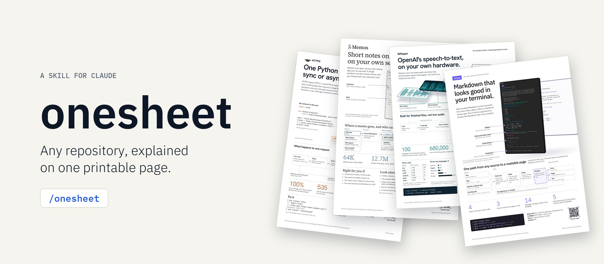
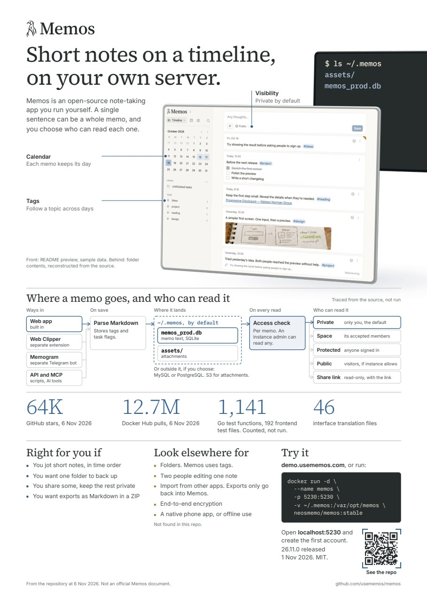
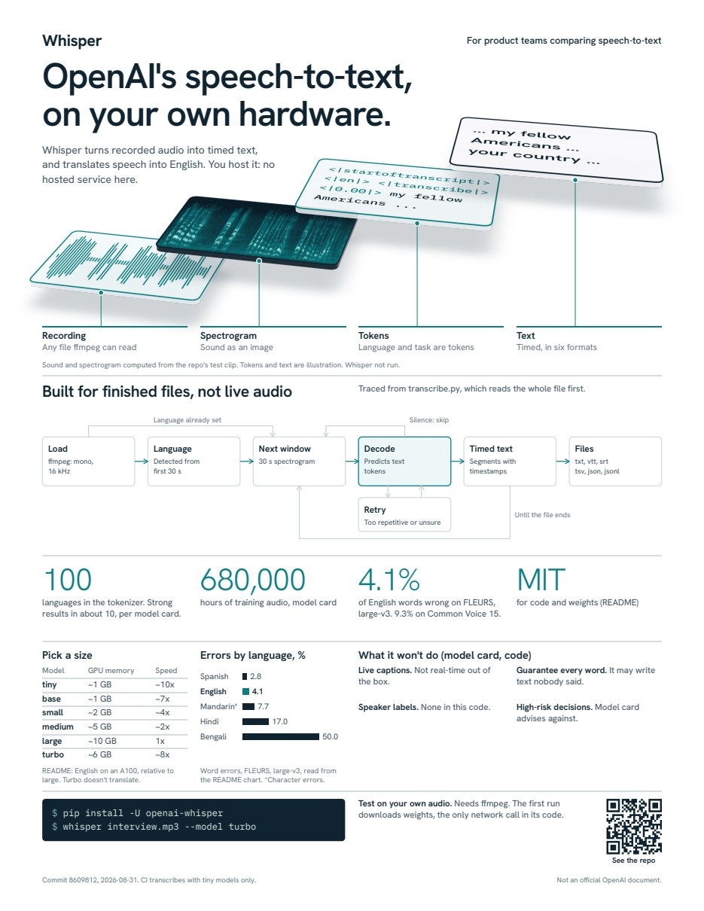
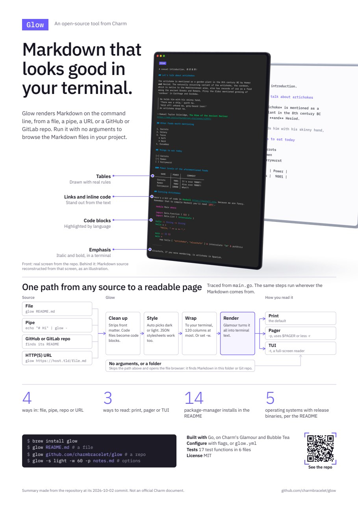
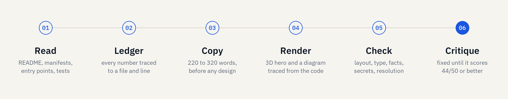

<picture>
  <source media="(prefers-color-scheme: dark)" srcset="docs/banner-dark.jpg">
  
</picture>

<p align="center">
  <b>Type <code>/onesheet</code> in any project. Get one printable page that explains it.</b><br>
  A 3D hero, a diagram traced from the code, real numbers with sources, and the command to try it.
</p>

<p align="center">
  <a href="#install">Install</a> &nbsp;·&nbsp;
  <a href="#use">Use</a> &nbsp;·&nbsp;
  <a href="#how-it-works">How it works</a> &nbsp;·&nbsp;
  <a href="#where-it-runs">Where it runs</a> &nbsp;·&nbsp;
  <a href="#what-it-runs-and-fetches">Privacy</a>
</p>

<p align="center"><sub>Claude Code · claude.ai · Claude Desktop &nbsp;|&nbsp; MIT licensed &nbsp;|&nbsp; v1.1.1</sub></p>

<br>

In film, a one-sheet is the single poster that sells a movie. This is that, for a repo: the page you hand someone so they get the idea without reading the code or the README.

## Why

A good one-page explainer of a project usually costs an afternoon of prompting. You write a long prompt describing the layout, the tone and what to include. You check the numbers by hand, ask for fixes, paste the result into a design tool, and go round again until it looks right.

onesheet replaces that loop with one command. The long prompt lives inside the skill: how to read a repo, which facts are allowed on the page, how to lay it out, and how to judge the result. The skill does the rounds of checking and fixing itself, before you see anything.

You type `/onesheet` and get a finished page: accurate, designed, and ready to print or share.

## Examples

<table>
  <tr>
    <td width="25%"></td>
    <td width="25%"></td>
    <td width="25%"></td>
    <td width="25%"></td>
  </tr>
  <tr>
    <td align="center"><b>HTTPX</b><br><sub>Library</sub></td>
    <td align="center"><b>Memos</b><br><sub>Web app</sub></td>
    <td align="center"><b>Whisper</b><br><sub>ML project</sub></td>
    <td align="center"><b>Glow</b><br><sub>CLI</sub></td>
  </tr>
</table>

Each page was made by the skill from the public repo alone. They're unofficial summaries, not documents from those projects. The full PDFs are attached to the [latest release](https://github.com/prabindersinghh/onesheet/releases/latest).

## Install

**Claude Code**

```
/plugin marketplace add prabindersinghh/onesheet
/plugin install onesheet@onesheet
```

Or copy [skills/onesheet](skills/onesheet/) into `~/.claude/skills/` to use it as a personal skill.

**claude.ai and Claude Desktop**

Install it from the Claude plugin directory once it's listed there. Until then, zip the [skills/onesheet](skills/onesheet/) folder and upload it as a custom skill in Settings. Either way, turn on **Code execution and file creation**.

## Use

Open your project and type:

```
/onesheet
```

That's it. You get `<repo>-one-pager.pdf` in the folder.

For a public repo you don't have open, give its URL: `/onesheet https://github.com/owner/repo`. You can also just ask, for example "make a one-pager for this repo". If another command already uses the name, type `/onesheet:onesheet`.

| Option | Default | Effect |
|---|---|---|
| repo | the project you have open | A local folder, or a public GitHub URL or `owner/name` |
| `--audience "..."` | technical peers new to the project | Sets the vocabulary and what gets explained |
| `--no-internals` | off | Describes behaviour and hides model names, vendors, stack and hosting |
| `--letter` | A4 | US Letter |
| `--out path` | `<repo>-one-pager.pdf` in the current folder | Where the PDF goes |

## How it works

<picture>
  <source media="(prefers-color-scheme: dark)" srcset="docs/pipeline-dark.png">
  
</picture>

1. **Read.** README, manifests, entry points, tests, licence and history. It never runs the repo's code or install scripts.
2. **Ledger.** Every number and claim on the page has to trace to a file and line. Claims the code doesn't back are printed as "the README reports", or left out.
3. **Copy.** 220 to 320 words, written before any design.
4. **Render.** A 3D hero, and a flow diagram drawn as vector and traced from the code.
5. **Check.** Automated checks on the PDF: one page, word budget, type sizes, collisions, text on renders, image resolution, banned words, secret-like strings, numbers missing from the ledger, and a QR code that decodes.
6. **Critique.** It looks at the rendered page, fixes it, and scores it on ten lines. It delivers only at 44/50 with no line below 4.

The delivery message lists README claims the code contradicted, what it didn't read, what is labelled as illustration, and the score.

## Where it runs

onesheet picks one of two builds by itself, and tells you which.

| | Full build | Lite build |
|---|---|---|
| **Where** | Claude Code, or Cowork on your computer | claude.ai, Claude Desktop chat, and anywhere without a browser |
| **Needs** | Python 3.10+, Node 18+, Chrome or Edge, internet | Python with reportlab and pillow |
| **Hero** | A photographic 3D render, made in headless Chrome | Exact vector 3D: plates, screens and blocks drawn in perspective |
| **Checks** | Layout, type, words, facts, banned words, secrets, resolution, QR decode | The same, except the QR decode |

Both keep the same fact ledger, rules and quality bar. See them side by side on [hyperfine](docs/compare-hyperfine.jpg) and [HTTPX](docs/compare-httpx.jpg).

In claude.ai, if the sandbox can't download a repo, upload it as a zip. GitHub gives you one under **Code > Download ZIP**.

## What it runs and fetches

Everything runs on your machine. Nothing from the repo, the page or your machine is sent anywhere else.

- **The repo:** the project you have open, a folder you name, or `git clone --depth 50` of a public GitHub URL. It never uses your logins. For a private repo, clone it yourself and run `/onesheet` inside it. The repo's code is read, never run, and its install scripts are never run.
- **Its own work folder:** `.onesheet/<repo>/work` in your home folder, about 150 MB of tools, kept outside your project so the page can be edited later. Your project only gets the PDF.
- **Lite build:** only reportlab and pillow, plus pypdf and pypdfium2 when present. Its fonts, IBM Plex Sans and Mono under the SIL Open Font License, ship with the skill, so it fetches nothing else.
- **Full build tools, installed into `work/`:** a Python virtual environment with pillow 13.0.0, pypdf 6.21.4 and pypdfium2 5.14.0 from PyPI, and playwright 1.49.1, qrcode 1.5.3, jsqr 1.4.0, pngjs 7.0.0 and three.js 0.170.0 from npm. three.js renders the 3D hero and is loaded from `work/`, not from a CDN. Playwright uses your installed Chrome or Edge.
- **Fonts:** static font files from Google Fonts, chosen per page.
- **A local web server:** `build.py` serves `work/` on 127.0.0.1, on a free port, while it renders and prints. It stops when the command ends.
- **Public counts, sometimes:** the skill may read figures such as GitHub stars or Docker pulls from those services' public APIs. The page names the source and date.

Requests to Google Fonts, PyPI and npm carry only what they need to serve the files. See [PRIVACY.md](PRIVACY.md).

## Cost and status

A page takes about **15 to 30 minutes** and **210,000 to 265,000 tokens**. That's about twice a plain attempt, spent on the critique rounds.

The full build is tested on Windows 11 with Chrome, on a web app, a library, an ML project and two CLIs. The lite build is tested on a CLI and a library in a Python-only setup that mimics a chat sandbox, but not yet inside claude.ai itself. Not yet tested: macOS or Linux, private or very large repos, `--no-internals`, and heroes built from a repo's own 3D model. [Reports are welcome](https://github.com/prabindersinghh/onesheet/issues).

## Develop

`dev/kit_selftest.py` sets up a work folder, renders every scene type, and builds pages that each break one check, to prove each check fails. Run it from the repo root with a scratch folder outside the repo:

```
python dev/kit_selftest.py ../onesheet-selftest
```

`dev/evals.json` holds the three end-to-end test prompts.

## License

[MIT](LICENSE). The bundled IBM Plex fonts are under the [SIL Open Font License](skills/onesheet/assets/fonts/OFL.txt).
