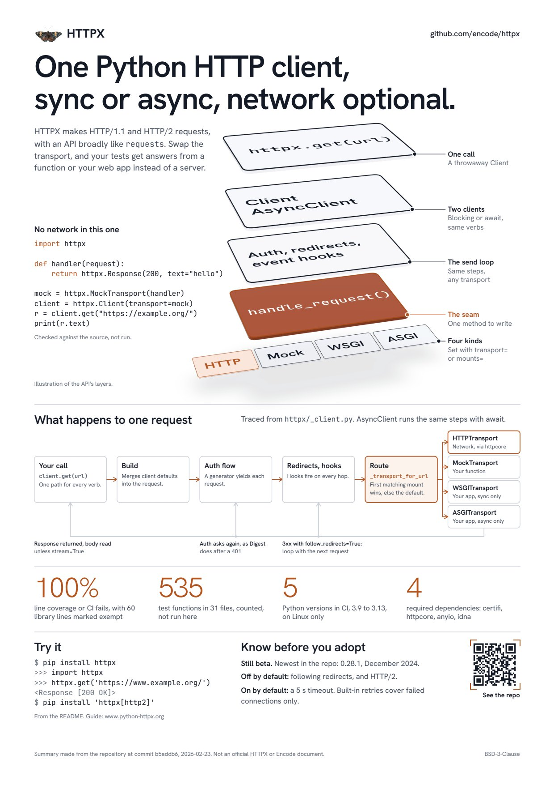

# onesheet

A Claude Code skill that turns a repository into a single printable page: a 3D hero, a diagram traced from the code, real numbers with sources, and the command to try it.

In film, a one-sheet is the single poster that sells a movie. This is that, for a repo.

| Library | Web app | ML project | CLI |
|---|---|---|---|
|  |  |  |  |

Each example was made by the skill from the public repo alone. They're unofficial summaries, not documents from those projects. The full PDFs are attached to the [latest release](https://github.com/prabindersinghh/onesheet/releases/latest).

## Install

In Claude Code:

```
/plugin marketplace add prabindersinghh/onesheet
/plugin install onesheet@onesheet
```

Or copy [`skills/onesheet`](skills/onesheet/) into `~/.claude/skills/` to use it as a personal skill.

## Use

```
/onesheet:onesheet https://github.com/owner/repo
```

You can also just ask, for example "make a one-pager for this repo". If you copied the folder in, the command is `/onesheet`.

| Option | Default | Effect |
|---|---|---|
| repo | the current folder | A local path, a GitHub URL, or `owner/name` |
| `--audience "..."` | technical peers new to the project | Sets the vocabulary and what gets explained |
| `--no-internals` | off | Describes behaviour and hides model names, vendors, stack and hosting |
| `--letter` | A4 | US Letter |
| `--out path` | `<repo>-one-pager.pdf` | Where the PDF goes. The editable `work/` folder goes beside it. |

## What it does

1. Reads the repo: README, manifests, entry points, tests, licence and history. It never runs the repo's code or install scripts.
2. Writes a fact ledger. Every number and claim on the page has to trace to a file and line, and claims the code doesn't back are printed as "the README reports" or left out.
3. Writes 220 to 320 words of copy before any design.
4. Renders a 3D hero with three.js in headless Chrome and draws the flow diagram as vector SVG.
5. Prints the PDF and runs automated checks: one page, word budget, type sizes, collisions, text on renders, image resolution, banned words, secret-like strings, numbers missing from the ledger, and a QR code that decodes.
6. Critiques the rasterized page and fixes it, scoring it on ten lines. It delivers only at 44/50 with no line below 4.

The delivery message lists README claims the code contradicted, what it didn't read, what is labelled as illustration, and its score.

## Requirements

- Claude Code on your own computer, or a Cowork session that runs on your computer. It can't build a page in claude.ai chat, which has no browser to render with, and it says so and stops.
- Python 3.10 or newer, Node 18 or newer, and Chrome or Edge
- Internet access

## What it runs and fetches

Everything runs on your machine, in a `work/` folder beside the PDF.

- **The repo:** `git clone --depth 50` of the URL you give. For a private repo it uses `gh repo clone`, which signs in with your own GitHub CLI login and talks only to GitHub. The skill never reads, prints or stores the token. The repo's code is read, never run, and its install scripts are never run.
- **Tools, installed into `work/`:** a Python virtual environment with pillow 13.0.0, pypdf 6.21.4 and pypdfium2 5.14.0 from PyPI, and playwright 1.49.1, qrcode 1.5.3, jsqr 1.4.0 and pngjs 7.0.0 from npm. Playwright uses your installed Chrome or Edge.
- **Fonts:** static font files from Google Fonts, chosen per page.
- **three.js 0.170.0:** loaded from the unpkg CDN inside headless Chrome, to render the 3D hero.
- **A local web server:** `build.py` serves `work/` on 127.0.0.1, on a free port, while it renders and prints. It stops when the command ends.
- **Public counts, sometimes:** the skill may read figures such as GitHub stars or Docker pulls from those services' public APIs. The page names the source and date.

Nothing from the repo, the page or your machine is sent anywhere else. Requests to Google Fonts, unpkg, PyPI and npm carry only what they need to serve the files.

## Cost and status

A page takes about 15 to 30 minutes and 210,000 to 265,000 tokens. That's about twice a plain attempt, spent on the critique rounds.

Tested on Windows 11 with Chrome, on a web app, a library, an ML project and two CLIs. Not yet tested on macOS or Linux, private or very large repos, `--no-internals`, or heroes built from a repo's own 3D model. Reports from those are welcome.

## Develop

`dev/kit_selftest.py` sets up a work folder, renders every scene type, and builds pages that each break one check, to prove each check fails. Run it from the repo root with a scratch folder outside the repo:

```
python dev/kit_selftest.py ../onesheet-selftest
```

`dev/evals.json` holds the three end-to-end test prompts.

## License

[MIT](LICENSE)
