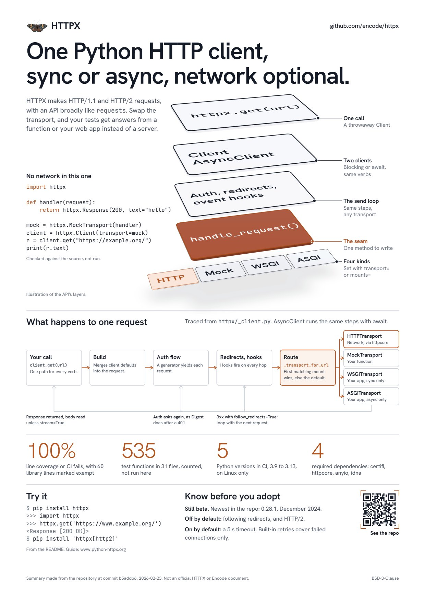
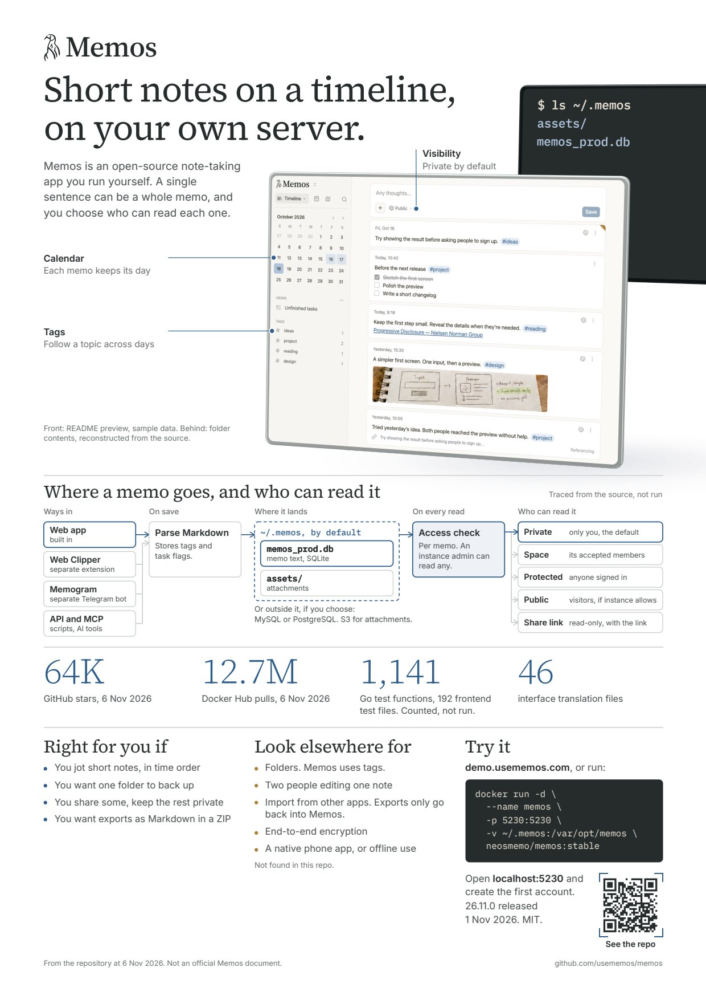
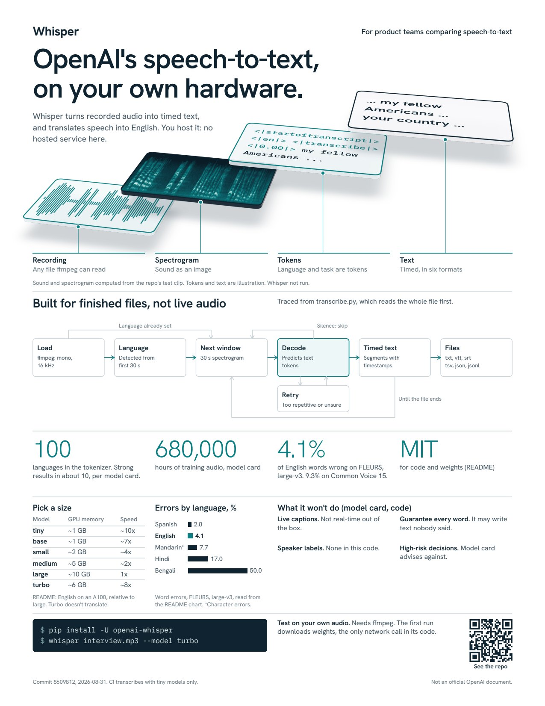
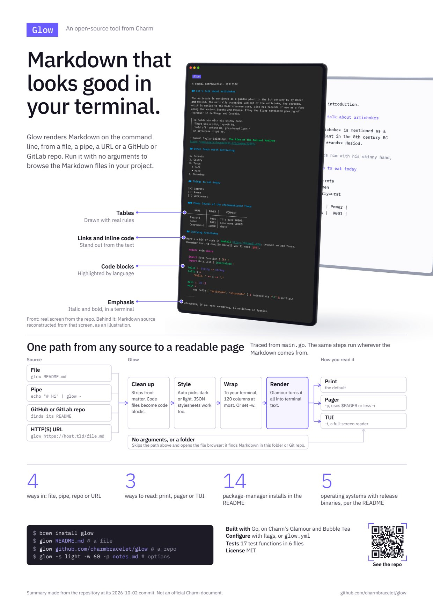

# onesheet, directory edition

Type `/onesheet` in any project and get one printable page that explains it: a 3D hero, a diagram traced from the code, real numbers with sources, and the command to try it.

This is the edition listed in the Claude plugin directory. It is made only of instructions, fonts and reference images. It ships no program: Claude writes a small page builder for each run from a precise blueprint, then builds, checks and critiques the page. It runs the same way in Claude Code, Cowork, claude.ai and the Claude desktop app.

The [main edition](https://github.com/prabindersinghh/onesheet#readme) in the same repo ships a tested engine with a photographic 3D renderer for Claude Code. Install that one from GitHub if you want the photographic hero.

| HTTPX | Memos | Whisper | Glow |
|---|---|---|---|
|  |  |  |  |

These reference pages set the quality bar the skill works to. They're unofficial summaries, not documents from those projects.

## Use

```
/onesheet
```

With no argument it uses the project you have open. You can also name a folder, a public GitHub URL or `owner/name`, and add `--audience "..."`, `--no-internals`, `--letter` or `--out path`. In claude.ai, turn on **Code execution and file creation** in Settings.

## How it works

1. **Read.** README, manifests, entry points, tests, licence and history. It never runs the repo's code.
2. **Ledger.** Every number and claim on the page traces to a file and line.
3. **Copy.** 220 to 320 words, written before any design.
4. **Build.** Claude writes the page builder from `references/BLUEPRINT.md`: exact text measurement, exact orthographic 3D, and the page checks. It tests the checks on a broken page first.
5. **Check.** One page, word budget, type sizes, collisions, text on the hero, lines through text, missing glyphs, image sharpness, banned words, secret-like strings, and numbers missing from the ledger.
6. **Critique.** It looks at the rendered page, fixes it, and delivers only at 44/50 with no line below 4.

## What it runs and fetches

- **Code:** only the builder and page script Claude writes for the run, in Python, in a work folder outside your project: `.onesheet/<repo>/work` in your home folder, or the chat sandbox. It never runs the repo's code or install scripts.
- **Libraries:** reportlab and pillow, plus pypdf and pypdfium2 for text checks and previews. If they're missing, it tells you and installs them from PyPI with pip.
- **The repo:** the project you have open, a folder you name, or a shallow `git clone` of a public GitHub URL. It never uses your logins.
- **Fonts:** IBM Plex Sans and Mono, bundled under the SIL Open Font License. Nothing is downloaded for them.
- **Public counts, sometimes:** figures such as GitHub stars, with the source and date on the page.

Nothing from the repo, the page or your machine is sent anywhere else. See [PRIVACY.md](PRIVACY.md).

## License

[MIT](LICENSE). The bundled fonts are under the [SIL Open Font License](skills/onesheet/assets/fonts/OFL.txt).
